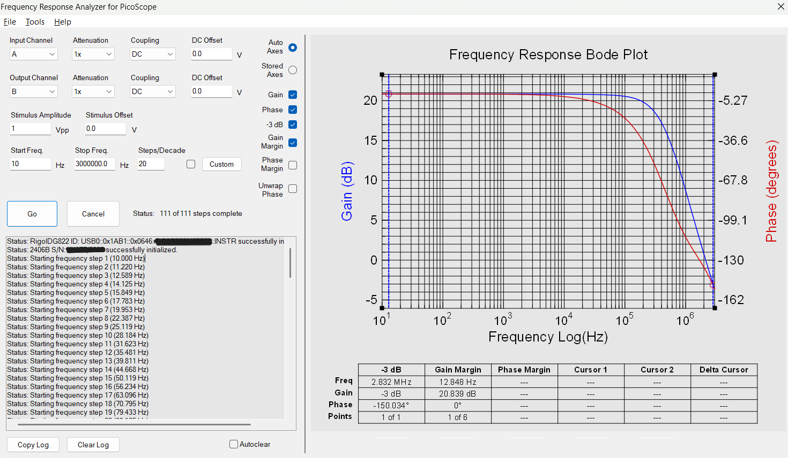

# Rigol DG822 Pro Plugin for FRA4PicoScope

Use your **Rigol DG822 Pro** as an external signal generator in **FRA4PicoScope**. This plugin lets FRA4PicoScope set the generator's frequency, amplitude, and DC offset automatically during a Bode plot measurement.

**[Download RigolDG822.dll — v0.1.1](https://github.com/nidalsaid04-ops/FRA4PicoScope-Rigol-DG-822-Pro/releases/download/v0.1.1/RigolDG822.dll)** · [All releases](https://github.com/nidalsaid04-ops/FRA4PicoScope-Rigol-DG-822-Pro/releases) · [Report a problem](https://github.com/nidalsaid04-ops/FRA4PicoScope-Rigol-DG-822-Pro/issues)

> **First working release:** tested over USB with a Rigol DG822 Pro and a PicoScope 2406B. The downloadable DLL is a **Windows 32-bit (Win32)** build. Testing with other setups is welcome.



[Installation](#installation) · [Settings](#settings) · [Troubleshooting](#troubleshooting) · [Build from source](#build-from-source)

## Installation

### What you need

| Component | Requirement |
| --- | --- |
| Computer | Windows 10 or Windows 11 |
| FRA4PicoScope | A 32-bit build with external signal-generator plugin support |
| VISA runtime | Support for 32-bit applications and communication with the Rigol |
| Signal generator | Rigol DG822 Pro connected through USB |
| Oscilloscope | A PicoScope supported by your FRA4PicoScope build |

VISA is the software layer that lets the plugin communicate with the generator. Its 32-bit support is required even when Windows itself is 64-bit.

### Set up the plugin

1. **Download** `RigolDG822.dll` using the link above. You can also find it under **Assets** on the release page.
2. **Install the VISA runtime**, then connect and turn on the generator and PicoScope.
3. **Check communication:** confirm that your VISA software detects the Rigol and receives a response to `*IDN?`.
4. **Close FRA4PicoScope** and copy the DLL into the external signal-generator plugin folder specified by your FRA4PicoScope build. The folder location depends on that build.
5. **Restart FRA4PicoScope** and select the Rigol external signal generator. Confirm that both instruments initialize successfully before starting a sweep.

Visual Studio is needed only if you choose to [build the plugin from source](#build-from-source).

## Settings

### Generator options

If FRA4PicoScope asks for an initialization string, this selects the default settings:

```text
CH=1;LOAD=HIGHZ;TIMEOUT=2000
```

| Option | Meaning | Accepted values |
| --- | --- | --- |
| `CH` | Generator output channel | `1` or `2` |
| `LOAD` | Load used for the generator's amplitude setting | `HIGHZ` or `50` |
| `TIMEOUT` | VISA communication timeout, in milliseconds | `100` to `60000` |

Choose the load setting to match the connected load: `HIGHZ` for a high-impedance input, or `50` for a 50 Ω terminated input. Leaving the initialization string empty uses the defaults above.

### Sweeps up to 20 MHz with a 500 MS/s capture rate

The following settings worked with the tested PicoScope 2406B setup:

| Setting in **Tools → Settings** | Value |
| --- | --- |
| FRA execution mode | **Low noise mode** |
| Minimum cycles | **16** |
| Low noise oversampling | **16** |

The default oversampling value of 64 requests 64 samples per signal cycle. Above approximately **7.8 MHz**, this exceeds a 500 MS/s capture rate and produces an **“Actual sampling frequency less than requested”** warning.

At 20 MHz, an oversampling value of 16 requests 320 MS/s. This stays below that limit. The oversampling setting applies to Low noise mode; other capture configurations may need different settings.

## Features

- Automatic discovery of compatible USB-connected DG822 generators.
- Sine-wave frequency, amplitude, and DC offset control.
- Channel 1 or 2 selection and High-Z or 50 Ω load settings.
- Instrument error checks and command-completion checks.
- Output-off attempts after communication failures, followed by connection cleanup.
- Output shutdown and front-panel unlocking during normal termination.

Communication uses the VISA API and SCPI instrument commands. On communication failure, an output-off command cannot be guaranteed to reach the instrument.

The tested model is the **DG822 Pro**. Support for other Rigol models has not been established.

## Troubleshooting

| Problem | What to check |
| --- | --- |
| Plugin does not appear | Use a FRA4PicoScope build with external-generator support. Check the DLL location, 32-bit application compatibility, and VISA runtime installation. |
| Generator is not detected | Check USB detection in your VISA software and try `*IDN?`. The optional Python test below can help. |
| Sampling-rate warning at high frequencies | Check **Low noise oversampling** against the available capture rate. See [Settings](#settings). |
| Build cannot find `ExtSigGen.h` | This standalone repository stores the header in `include/`. Configure the project to use that folder. |
| Build cannot find `visa.h` or `visa32.lib` | Install the VISA development files and check the compiler and linker paths in [Build from source](#build-from-source). |

### Optional Python connection test

With Python 3 and a VISA runtime installed, run these commands from the repository's root folder:

```powershell
python -m pip install pyvisa
python .\Examples\visa_idn_test.py
```

The script searches VISA resources and sends `*IDN?`. A successful reply identifies the instrument. Python is only used for this optional test.

## Build from source

Use these steps to build or modify the **32-bit plugin**. They apply to this standalone repository.

### 1. Install the development tools

- Visual Studio 2022 with **Desktop development with C++**, the **v143** toolset, and a Windows SDK.
- A VISA development package containing `visa.h` and the 32-bit `visa32.lib`.
- Git, if you use the clone command below.

### 2. Get the source

```powershell
git clone https://github.com/nidalsaid04-ops/FRA4PicoScope-Rigol-DG-822-Pro.git
cd FRA4PicoScope-Rigol-DG-822-Pro
```

Open `RigolDG822/RigolDG822.vcxproj` in Visual Studio. Select **Release / Win32**.

### 3. Check the project settings

Open **Project → Properties** with **Release / Win32** selected. The published project contains paths from the original development setup; check them before building a fresh clone.

| Property | Required setting |
| --- | --- |
| General → Platform Toolset | **Visual Studio 2022 (v143)** |
| C/C++ → Language → C++ Language Standard | **ISO C++17** |
| C/C++ → General → Additional Include Directories | `$(ProjectDir)..\include` and the folder containing `visa.h` |
| Linker → General → Additional Library Directories | The folder containing the **32-bit** `visa32.lib` |
| Linker → Input → Additional Dependencies | `visa32.lib`; replace any `visa64.lib` entry for this Win32 build |

Keep inherited settings enabled when editing these fields.

For this repository, the project reference to `ExtSigGen.h` must be `..\include\ExtSigGen.h`. If the `.vcxproj` still refers to `..\FRA4PicoScope`, update that path in the standalone project.

A common VISA installation root is:

```text
C:\Program Files (x86)\IVI Foundation\VISA\WinNT
```

The 32-bit library may be under `lib\msc` or `Lib_x32\msc`, depending on the VISA package. Use the directory that actually contains `visa32.lib`.

If `RigolDG822.cpp` contains a hardcoded VISA library path, replace that `#pragma comment(lib, ...)` line with the following so it uses the linker directory configured above:

```cpp
#pragma comment(lib, "visa32.lib")
```

### 4. Build and install

Choose **Build → Build Solution**. Find `RigolDG822.dll` at the output path shown in the build log, then follow [Installation](#installation). The selected build platform determines the DLL architecture; the output folder's name alone does not.

### Source files

| Path | Purpose |
| --- | --- |
| `RigolDG822/RigolDG822.cpp` | Generator control and VISA communication |
| `RigolDG822/RigolDG822.h` | Plugin class declarations |
| `RigolDG822/RigolDG822.def` | Exported DLL functions |
| `RigolDG822/RigolDG822.vcxproj` | Visual Studio project |
| `include/ExtSigGen.h` | FRA4PicoScope external-generator interface |
| `Examples/` | Connection test and measurement screenshot |

## Feedback and contributions

[Open an issue](https://github.com/nidalsaid04-ops/FRA4PicoScope-Rigol-DG-822-Pro/issues) to report a problem or share a test result. Include the generator and PicoScope models, FRA4PicoScope and VISA versions, Windows version, connection type, and relevant error log.

Planned improvements include more detailed error messages, testing with additional models, and an automated build workflow.

## Credits and license

Created by **Nidal Said**, using the FRA4PicoScope external signal-generator interface. Thanks to the FRA4PicoScope project and its contributors.

Licensed under **GNU GPL v3.0 or later (GPL-3.0-or-later)**. See [LICENSE](LICENSE). Original copyright and attribution notices are retained; `ExtSigGen.h` comes from FRA4PicoScope.

This is an independent community project, not affiliated with or endorsed by Rigol Technologies or Pico Technology. Product names belong to their respective owners.
